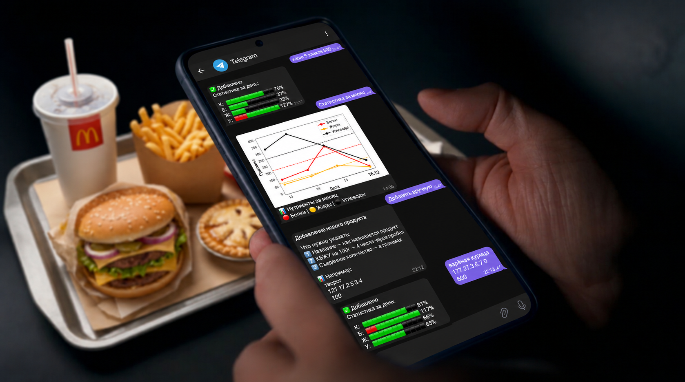

# Telegram KBZU Bot

Telegram-бот для отслеживания питания: расчёт КБЖУ, дневник приёмов пищи
и статистика прогресса. На Python и pyTelegramBotAPI.

## Задача

Разработать Telegram-бота для учёта рациона, исключающего ведение таблиц и ручной
расчёт. Обеспечить поиск продуктов как в локальной базе, так и через сторонние
источники данных. Предусмотреть раздельное сохранение каждого приёма пищи с
возможностью удаления ошибочных записей. Реализовать эргономичный интерфейс
управления дневником питания и отображение статистики за месяц.

## Реализация

- **Ядро** — классы `User` и `Product`: расчёт BMR по формуле Миффлина-Сан Жеора,
  суточных норм КБЖУ с учётом активности и цели.
- **Регистрация и профиль** — пошаговый ввод данных через inline-кнопки,
  редактирование профиля с пересчётом норм.
- **Добавление еды** — ручной ввод, поиск в локальной базе SQLite
  и через Open Food Facts API.
- **Хранение** — SQLite + JSON-сериализация объектов: пользователи,
  приёмы пищи и кеш продуктов. Автоочистка старых записей.
- **Статистика** — дневные прогресс-бары на эмодзи и месячные графики
  калорий и нутриентов через Matplotlib.
- **Архитектура** — `UserManager` и `FoodManager` для логики,
  отдельные классы для работы с БД, API и статистикой.

## Результат

- Регистрация с автоматическим расчётом норм калорий, белков, жиров и углеводов
- Три способа добавления еды: ручной ввод, локальная база, внешний API
- Удаление записей и редактирование профиля
- Дневная статистика с прогресс-барами
- Месячные графики калорий и нутриентов
- Обработка ошибок ввода, API и работы с базой данных
